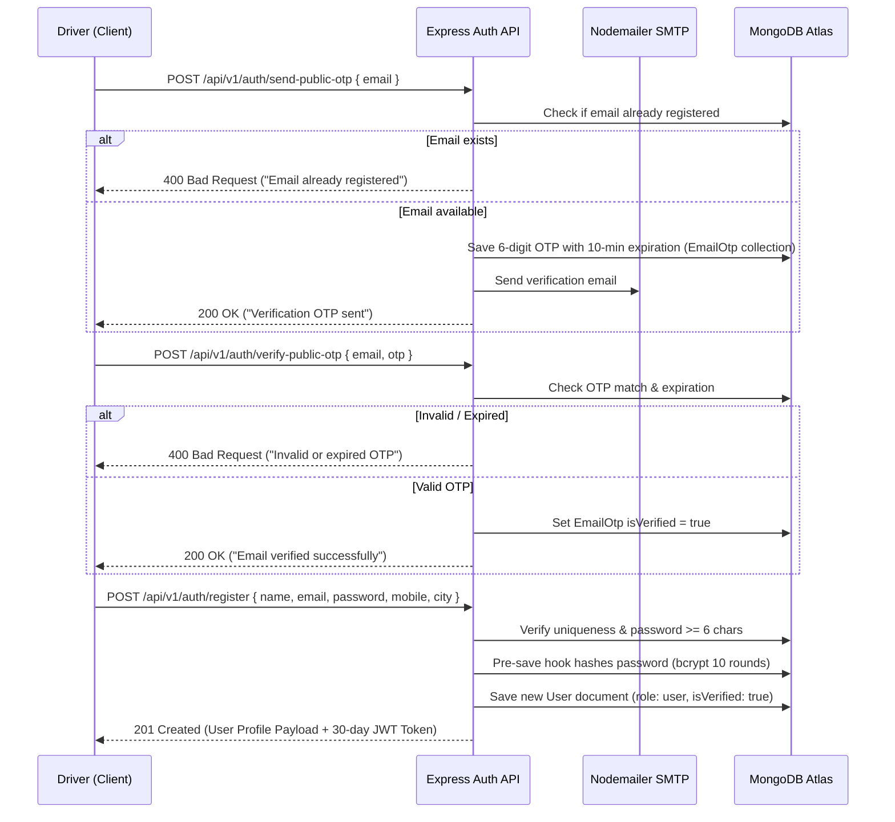
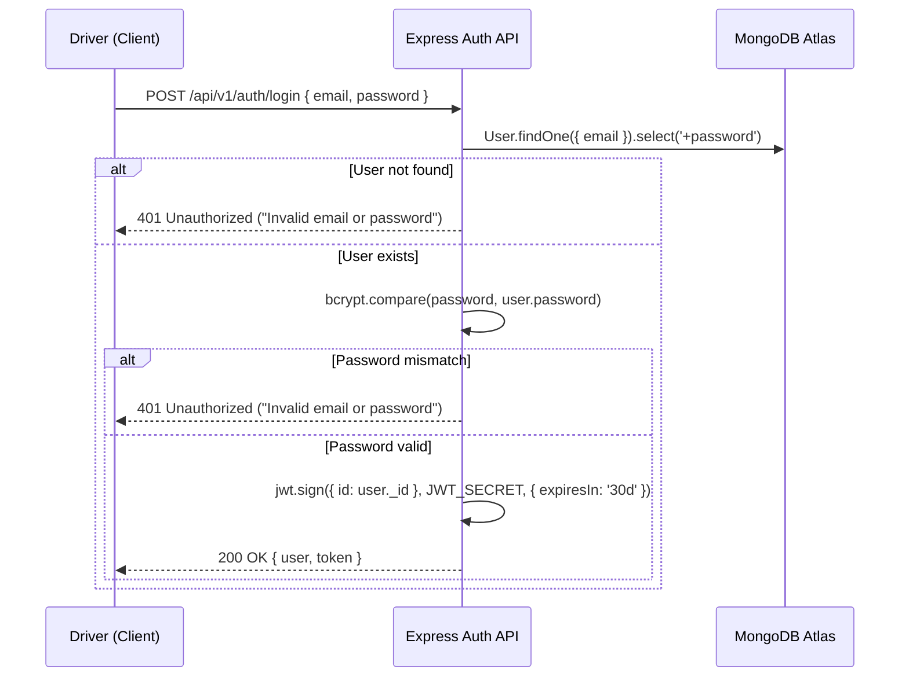

# Drivix – Authentication & Authorization Flow

## 1. Authentication Architecture Overview

Drivix uses a stateless, token-based authentication system powered by **JSON Web Tokens (JWT)** and **bcryptjs** password encryption, managed via the Express.js backend (`/api/v1/auth`).

The authentication architecture is decoupled from third-party vendor identity locks:
- User accounts and security credentials reside in the MongoDB Atlas `users` collection.
- Frontend and Mobile clients send the JWT token via HTTP `Authorization: Bearer <TOKEN>` headers.
- Background and client interceptors automatically handle session verification and authorization guards.

---

## 2. Authentication Methods & Workflows

### 2.1 Standard Email & Password Registration Flow



1. **Pre-Registration Email Verification**: Driver enters email; a 6-digit cryptographic OTP is generated, persisted with a 10-minute expiration window in `EmailOtp` (auto-purged by MongoDB TTL index), and delivered via SMTP.
2. **Registration Submission**: User submits details. Passwords must be at least 6 characters.
3. **Password Hashing**: The `UserSchema.pre('save')` hook evaluates `isModified('password')`. It generates a 10-round salt via `bcrypt.genSalt(10)` and securely hashes the password.
4. **Token Generation**: Upon creation, a JWT token signed with `process.env.JWT_SECRET` (30-day expiration) is returned to the client.

---

### 2.2 Email & Password Login Flow



- Passwords are never returned in database queries (`select: false` on the User model).
- Verification uses `user.matchPassword(enteredPassword)` executing `bcrypt.compare`.
- Automatic elevation: If the logging-in email is `drivixmobility@gmail.com`, the system automatically promotes the account to `admin`.

---

### 2.3 Google OAuth 2.0 Single Sign-On

- **Endpoint**: `POST /api/v1/auth/google`
- **Workflow**:
  1. Frontend displays Google Sign-In button using Google Identity Services (`window.google.accounts.id`).
  2. Google returns a signed ID token credential.
  3. Client posts the credential token to backend.
  4. Backend verifies the token with Google's public tokeninfo endpoint (`https://oauth2.googleapis.com/tokeninfo?id_token=${credential}`).
  5. Backend extracts validated `email`, `name`, and `picture`.
  6. Backend checks if the user exists in MongoDB. If not, it provisions a new user with a randomized strong password and `isVerified: true`.
  7. Returns standard Drivix JWT token.

---

### 2.4 Phone Number Authentication & Architectural Discrepancy Note

- Backend provides `POST /api/v1/auth/phone` which accepts a verified mobile number and returns or creates a driver profile with a JWT token.
- **Architectural Discrepancy Found in Codebase**:
  - In `WebApp/frontend/src/pages/Auth.jsx`, phone login invokes Firebase `RecaptchaVerifier` and `signInWithPhoneNumber(auth, ...)`.
  - However, `WebApp/frontend/src/firebase.js` exports a mock stub where `auth` is empty (`export const auth = { currentUser: null, ... }`).
  - As a result, triggering phone authentication on the web frontend fails due to the unconfigured Firebase client. The standard email/password and Google OAuth flows should be used.

---

## 3. JWT Token Specification & Storage

### Token Payload & Expiration
```json
{
  "id": "66901a1f4b8c9d0012ef34ab",
  "iat": 1729000000,
  "exp": 1731592000
}
```
- **Signing Algorithm**: HMAC SHA-256 (`HS256`)
- **Secret**: `process.env.JWT_SECRET`
- **Validity Duration**: 30 days (`'30d'`)

### Client-Side Storage
| Client | Storage Mechanism | Storage Keys | Lifecycle |
| :--- | :--- | :--- | :--- |
| **Web Frontend (`WebApp/frontend`)** | Browser `localStorage` | `drivix_auth_token`<br>`drivix_user_uid` | Persists across browser sessions until explicit logout or 401 token invalidation. |
| **Mobile App (`App/`)** | React Native `AsyncStorage` | `storage.saveToken(token)` | Stored encrypted in OS sandbox; automatically injected into Axios request headers. |

---

## 4. Role-Based Access Control (RBAC)

Drivix enforces a two-tier Role-Based Access Control model:

```
[ Unauthenticated Public ]  -->  Browsing parking locations, live floor availability, viewing public banners
             |
[ Authenticated 'user' ]     -->  Booking slots, holding soft-locks, FASTag management, GPS navigation, filing complaints
             |
[ Authenticated 'admin' ]    -->  Global operations dashboard, facility/slot CRUD, bulk slot generation, user plan updates, partner application approval
```

### Backend Enforcement Middleware (`authMiddleware.js`)
1. **`protect` Middleware**:
   - Parses `req.headers.authorization`.
   - Strips `Bearer ` prefix.
   - Verifies token signature with `jwt.verify(token, process.env.JWT_SECRET)`.
   - Queries `User.findById(decoded.id).select('-password')`.
   - Attaches authenticated user object to `req.user`. Returns `401 Unauthorized` if invalid or missing.
2. **`adminOnly` Middleware**:
   - Checks `if (req.user && req.user.role === 'admin')`.
   - If user is not an admin, halts request pipeline with `403 Forbidden` (`{"message": "Not authorized as an admin"}`).

### Frontend Route Guards (`AdminRoute.jsx`)
- Wrapped around all `/admin/*` routes in `App.jsx`.
- Evaluates `useUser()` context:
  ```javascript
  if (!isAuthenticated || user?.role !== 'admin') {
    return <Navigate to="/" replace />;
  }
  ```
- Non-admin users attempting to open `/admin` routes are immediately redirected to the home page.
