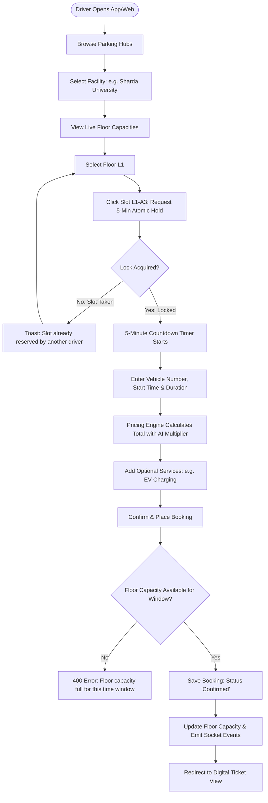
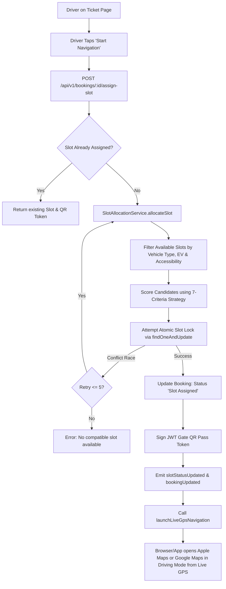
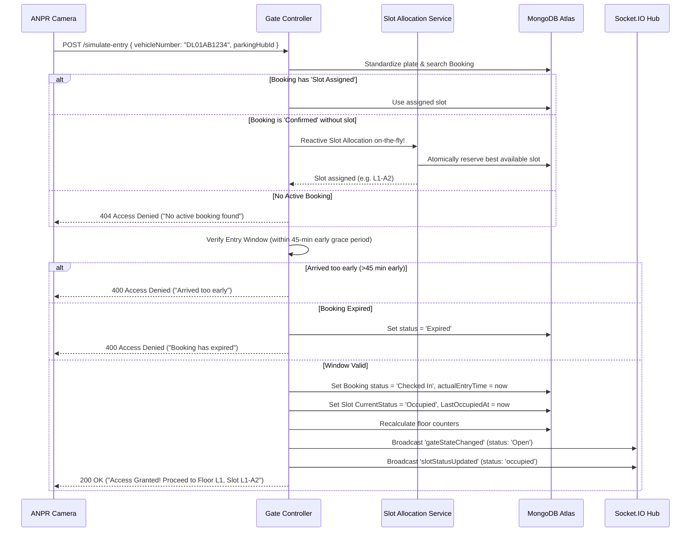
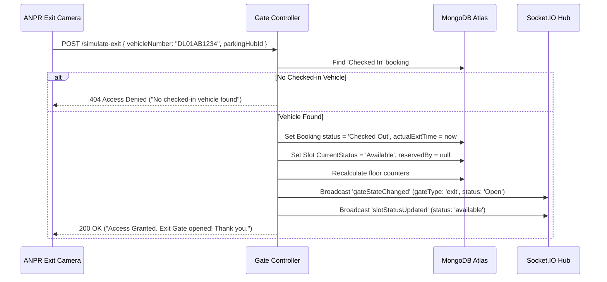

# Drivix – End-to-End Business Logic & User Journeys

## 1. Major Functional Modules

1. **Smart Discovery & Map Navigation**: Geolocation-aware facility search with real-time floor availability indicators.
2. **Floor Capacity & Atomic Soft-Locking**: Overlapping reservation checks with 5-minute atomic holds.
3. **Hybrid AI Dynamic Pricing**: Real-time demand and surge estimation based on capacity, peak hours, and weather.
4. **Reactive Slot Allocation Scoring Engine**: 7-criteria weighted slot matching algorithm.
5. **Direct Turn-by-Turn GPS Driving Navigation**: 1-tap live navigation launching native map driving intents.
6. **Optical ANPR Gate Simulator**: Autonomous barrier control, check-in, and check-out workflows.
7. **Session Timers & Automated Auto-Release Worker**: 10-second background cleanup daemon.
8. **FASTag Auto-Debit & Driver Hub Amenities**: FASTag management and in-hub car detailing booking.

---

## 2. End-to-End User Journeys

### 2.1 Journey 1: Smart Parking Search to Confirmed Booking



#### Detailed Business Rules:
1. **Operating Status Check**: A facility must be in `Active` status and have `allowOnlineBooking: true`.
2. **Time Window Guard**: Bookings cannot be created for dates or times in the past.
3. **Atomic 5-Minute Hold**: Clicking a slot triggers `POST /api/v1/parking/:facilityId/slots/:slotId/reserve`. MongoDB atomically executes:
   ```javascript
   findOneAndUpdate(
     { facilityId, id: slotId, status: 'available' },
     { $set: { status: 'temporarily_reserved', reservedBy: user._id, reservationExpiresAt: now + 5 min } }
   )
   ```
4. **Capacity Overlap Algorithm**:
   - Instead of static slot counts, `getOverlappingCount()` checks all active bookings (`'Confirmed'`, `'Slot Assigned'`, `'Checked In'`) whose time intervals overlap the requested `[startTime, startTime + duration]`.
   - If `overlappingCount >= floor.totalSlots`, reservation is rejected with `CAPACITY_FULL`.

---

### 2.2 Journey 2: Dynamic Slot Allocation & Turn-by-Turn GPS Navigation



#### Multi-Criteria Scoring Strategy:
The scoring engine ranks candidate slots based on `SLOT_ALLOCATION_WEIGHTS`:
$$\text{Score} = \sum (\text{Metric Weight} \times \text{Factor Score})$$

1. **Same Floor Match (30%)**: 100 points if slot is on requested floor, 0 otherwise.
2. **Walking Distance (25%)**: $\max(0, 100 - \text{distanceInMeters})$.
3. **Zone Compatibility (15%)**: Row A = 100, Row B = 60, Row C = 30.
4. **Vehicle Compatibility (10%)**: Car vs Bike type match.
5. **EV Requirement (10%)**: Strictly filtered. If vehicle is EV or service requested, EVSupported = 100, else standard slots preferred.
6. **Accessibility (5%)**: Designated accessible slots reserved for disabled drivers.
7. **Exit / Elevator Proximity (5%)**: Evaluates proximity to lifts and egress stairs.

---

### 2.3 Journey 3: ANPR Barrier Entry & Reactive Check-In



---

### 2.4 Journey 4: ANPR Exit Gate Check-Out & Bill Settlement



---

### 2.5 Journey 5: Background Daemon Maintenance & Auto-Sweep Worker

Runs continuously every **10 seconds** in `WebApp/backend/server.js`:

1. **Sweep 1: Expired Soft-Locks**:
   - Queries `Slot.find({ status: 'temporarily_reserved', reservationExpiresAt: { $lt: now } })`.
   - Reverts `status = 'available'`, clears `reservedBy` and `reservationExpiresAt`.
   - Emits `slotStatusUpdated` via Socket.IO so all client browser grids update in real time.
2. **Sweep 2: Overdue Active Bookings**:
   - Queries active bookings past their scheduled end time.
   - If booking was `'Checked In'`, transitions to `'Checked Out'`. Otherwise marks `'Expired'`.
   - Frees linked slot back to `'available'` and synchronizes floor capacity counters.
3. **Sweep 3: Auto-Allocation for Approaching Reservations**:
   - Queries bookings where start time is within `ASSIGNMENT_THRESHOLD_MINUTES` (30 minutes) and slot is unassigned.
   - Automatically executes `SlotAllocationService.allocateSlot()`.
4. **Sweep 4: 30-Minute Arrival Check Prompt**:
   - Emits `arrivalConfirmationPrompt` via Socket.IO to remind driver of upcoming reservation.
   - If driver is more than 15 minutes late past start time without confirming, marks booking `'Expired'`.

