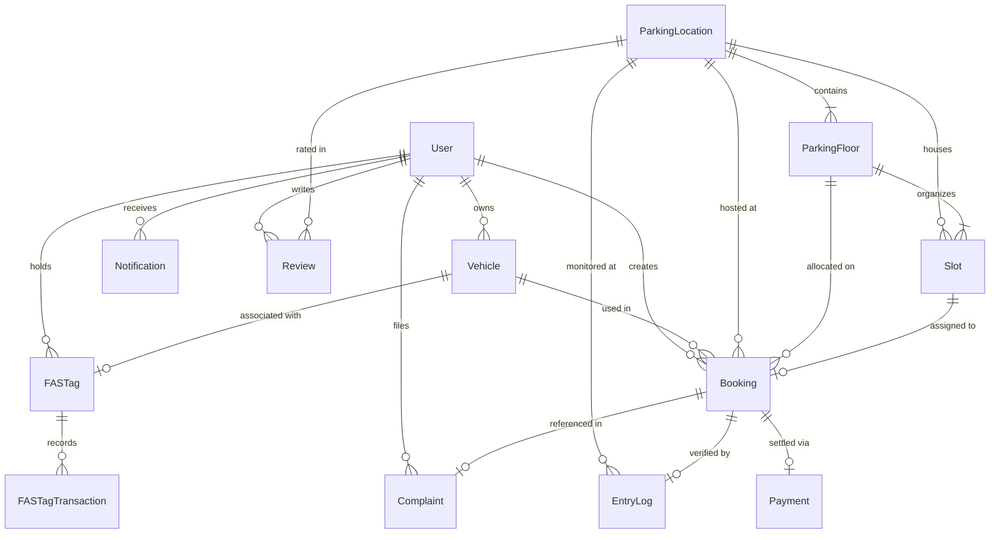

# Drivix – Database Architecture & Schema Reference

## 1. Overview & Technology

The primary database for Drivix is **MongoDB Atlas** (Cloud Document Database) utilizing **Mongoose 9.7** as the Object Document Mapper (ODM).

### Key Architectural Characteristics
- **Hybrid Relational-Document Model**: Uses normalized references (`mongoose.Schema.Types.ObjectId`) with virtual populates to keep documents compact and $O(1)$ in storage size while maintaining fast read performance.
- **Atomic Operations for Concurrency**: Slot reservations and booking state transitions use atomic database operators (`findOneAndUpdate`, `$set`, `$inc`) to guarantee consistency under high-throughput concurrent access.
- **Dual-Field Backward Compatibility**: Core entities (`Booking` and `Slot`) feature pre-validation hooks that transparently synchronize newer hierarchical fields (`floorId`, `slotId`, `parkingHubId`) with legacy flat fields (`floor`, `id`, `locationId`) to prevent breaking legacy client versions.
- **Automatic TTL Deletion**: Verification tokens in `EmailOtp` utilize MongoDB TTL (Time-To-Live) indexes for automated document destruction upon expiration.
- **Failover Architecture**: The application attempts connection to MongoDB Atlas first with a 5-second timeout; if unreachable, it falls back to a local MongoDB instance (`mongodb://127.0.0.1:27017/drivix`) for offline resilience.

---

## 2. Entity Relationship Diagram (ERD)

---

## 3. Detailed Collection Schemas

### 3.1 `users` Collection (Model: `User`)
Stores registered driver accounts, credentials, contact information, role permissions, embedded documents, and preferences.

| Field Name | Data Type | Constraints / Attributes | Description |
| :--- | :--- | :--- | :--- |
| `_id` | ObjectId | Primary Key, Auto-generated | Unique user identifier |
| `fullName` | String | Required | Full display name of the driver |
| `name` | String | Optional | Legacy name attribute (synced with fullName) |
| `email` | String | Unique, Sparse, Trim, Lowercase, Regex | Account email address |
| `password` | String | Select: false | Bcrypt hashed password (10 salt rounds) |
| `mobile` | String | Default: '' | Contact mobile phone number |
| `city` | String | Default: '' | Registered home city |
| `drivingLicence` | String | Default: '' | Driving licence identifier string |
| `isProfileCompleted` | Boolean | Default: false | Onboarding completion flag |
| `profileImage` | String | Default: '' | URL or base64 profile picture |
| `walletBalance` | Number | Default: 0, Min: 0 | In-app digital wallet credit balance in INR |
| `role` | String | Enum: `['user', 'admin']`, Default: `'user'` | Role-based access control level |
| `membershipType` | String | Enum: `['Free', 'Premium']`, Default: `'Free'` | Subscription tier |
| `membershipExpiry`| Date | Default: null | Subscription expiration timestamp |
| `isVerified` | Boolean | Default: false | Email verification status flag |
| `emailOtp` | String | Optional | Active verification OTP code |
| `emailOtpExpires`| Date | Optional | Expiry timestamp for emailOtp |
| `vehicles` | Array[SubDoc] | Schema: `{ plate, model, isPrimary }` | Embedded vehicle summary list |
| `documents` | Array[SubDoc] | Schema: `{ name, type, fileUrl, uploadedAt, expiryDate, remindersEnabled }` | Driver compliance document vault (DL, RC, PUC) |
| `paymentMethods` | Array[SubDoc] | Schema: `{ type, label, provider }` | Saved payment methods (cards, UPI) |
| `preferences` | Object | SubFields: `parkingType` (Default: 'Open Space'), `evCharging` (Default: false) | Driver allocation preferences |
| `notifications` | Object | SubFields: `push` (true), `email` (true), `whatsapp` (true) | Notification delivery preferences |
| `createdAt` | Date | Auto-generated | Document creation timestamp |
| `updatedAt` | Date | Auto-generated | Last modification timestamp |

**Virtuals:**
- `ownedVehicles`: One-to-Many virtual resolving to `Vehicle` collection where `Vehicle.userId === User._id`.
- `bookings`: One-to-Many virtual resolving to `Booking` collection where `Booking.userId === User._id`.

---

### 3.2 `vehicles` Collection (Model: `Vehicle`)
Standalone vehicle asset entities owned by registered users.

| Field Name | Data Type | Constraints / Attributes | Description |
| :--- | :--- | :--- | :--- |
| `_id` | ObjectId | Primary Key, Auto-generated | Unique vehicle identifier |
| `userId` | ObjectId | Required, Ref: `'User'`, Index: true | Foreign key referencing vehicle owner |
| `vehicleNumber` | String | Required, Unique, Trim, Index: true | License plate string (e.g. `UP16AB1234`) |
| `vehicleType` | String | Required | Vehicle category (`'Car'`, `'Bike'`, etc.) |
| `brand` | String | Default: '' | Vehicle manufacturer (e.g. `'Tata'`, `'Hyundai'`) |
| `model` | String | Default: '' | Vehicle model (e.g. `'Nexon EV'`, `'Creta'`) |
| `color` | String | Default: '' | Vehicle exterior color |
| `fuelType` | String | Enum: `['Petrol', 'Diesel', 'CNG', 'EV']`, Default: `'Petrol'` | Powertrain classification |
| `isPrimary` | Boolean | Default: false | Default vehicle indicator for 1-tap bookings |
| `createdAt` | Date | Auto-generated | Creation timestamp |
| `updatedAt` | Date | Auto-generated | Last update timestamp |

---

### 3.3 `parkinglocations` Collection (Models: `ParkingLocation` and `Parking`)
Authoritative parking facilities, shopping hubs, and metro parkings across Delhi NCR.

| Field Name | Data Type | Constraints / Attributes | Description |
| :--- | :--- | :--- | :--- |
| `_id` | ObjectId | Primary Key, Auto-generated | Unique parking facility identifier |
| `parkingName` | String | Required, Trim | Name of facility (e.g. `'Connaught Place Inner Circle'`) |
| `parkingCode` | String | Required, Unique, Uppercase, Trim, Index: true | Unique code identifier (e.g. `'CP-IN'`, `'SHARDA-01'`) |
| `address` | String | Required, Trim | Physical street address |
| `city` | String | Required, Trim | City (e.g. `'New Delhi'`, `'Noida'`) |
| `state` | String | Required, Trim | State (e.g. `'Delhi'`, `'Uttar Pradesh'`) |
| `pincode` | String | Default: null, Trim | Postal PIN code |
| `latitude` | Number | Default: null | Geographical latitude coordinate |
| `longitude` | Number | Default: null | Geographical longitude coordinate |
| `openingTime` | String | Default: null | Operating hours opening (e.g. `'06:00'`) |
| `closingTime` | String | Default: null | Operating hours closing (e.g. `'23:30'`) |
| `totalFloors` | Number | Default: null | Total number of building floors |
| `totalSlots` | Number | Default: null | Aggregate parking capacity across all floors |
| `availableSlots`| Number | Default: null | Current aggregate available slots count |
| `hourlyPrice` | Number | Default: null | Base standard hourly parking fee in INR |
| `amenities` | Array[String] | Default: [] | List of tags (`'EV Charging'`, `'CCTV'`, `'Covered'`) |
| `images` | Array[String] | Default: [] | Photo URLs of facility |
| `floors` | Array[String] | Default: [] | Floor names array (`['B1', 'B2', 'L1', 'L2']`) |
| `allowOnlineBooking` | Boolean | Default: false | Operational gate allowing online reservations |
| `status` | String | Enum: `['Active', 'Inactive', 'Pending', 'Restricted']`, Default: `'Active'` | Operational status |
| `createdAt` | Date | Auto-generated | Creation timestamp |
| `updatedAt` | Date | Auto-generated | Last update timestamp |

**Virtuals:**
- `floorsList`: Resolves to `ParkingFloor` collection where `ParkingFloor.parkingId === ParkingLocation._id`.

---

### 3.4 `parkingfloors` Collection (Model: `ParkingFloor`)
Floor-level subdivisions within parking facilities managing real-time floor capacities.

| Field Name | Data Type | Constraints / Attributes | Description |
| :--- | :--- | :--- | :--- |
| `_id` | ObjectId | Primary Key, Auto-generated | Unique floor identifier |
| `parkingHubId`| ObjectId | Required, Ref: `'ParkingLocation'`, Index: true | Foreign key referencing parent parking facility |
| `floorName` | String | Required, Trim | Floor name (e.g. `'L1'`, `'L2'`, `'B1'`) |
| `totalSlots` | Number | Default: 0, Min: 0 | Total parking slot capacity on this specific floor |
| `availableSlots` | Number | Default: 0, Min: 0 | Currently vacant slots on this floor |
| `occupiedSlots` | Number | Default: 0, Min: 0 | Slots occupied by checked-in vehicles |
| `reservedCapacity` | Number | Default: 0, Min: 0 | Slots reserved for confirmed upcoming bookings |
| `active` | Boolean | Default: true | Floor operational state (can be closed for repairs) |
| `createdAt` | Date | Auto-generated | Creation timestamp |
| `updatedAt` | Date | Auto-generated | Last update timestamp |

**Compound Indexes:**
- `{ parkingHubId: 1, floorName: 1 }`: Unique index preventing duplicate floor names in the same facility.

**Virtuals:**
- `floorId`: Maps to `_id.toString()`.
- `totalCapacity`: Getter/Setter mapping to `totalSlots`.

---

### 3.5 `slots` Collection (Model: `Slot`)
Individual parking spaces holding atomic soft-lock and scoring parameters.

| Field Name | Data Type | Constraints / Attributes | Description |
| :--- | :--- | :--- | :--- |
| `_id` | ObjectId | Primary Key, Auto-generated | Unique database identifier |
| `facilityId` | ObjectId | Required, Ref: `'ParkingLocation'` | Foreign key to parent parking hub |
| `floorId` | ObjectId | Required, Ref: `'ParkingFloor'` | Foreign key to parent floor document |
| `slotId` | String | Required | Slot code (e.g. `'L1-A3'`), synchronized with `id` |
| `slotNumber` | String | Required | Number portion (e.g. `'A3'`) |
| `vehicleType` | String | Enum: `['Car', 'Bike', 'EV']`, Default: `'Car'` | Permitted vehicle category |
| `EVSupported` | Boolean | Default: false | Availability of EV charger at this slot |
| `NearElevator`| Boolean | Default: false | Proximity to elevator bank |
| `NearExit` | Boolean | Default: false | Proximity to exit ramp/gate |
| `Accessibility` | Boolean | Default: false | Designated accessible/disabled parking bay |
| `CurrentStatus`| String | Enum: `['Available', 'Reserved', 'Occupied', 'Maintenance']`, Default: `'Available'` | High-level status |
| `status` | String | Enum: `['available', 'temporarily_reserved', 'booked', 'occupied', 'maintenance']`, Default: `'available'` | Concurrency status |
| `reservedBy` | ObjectId | Ref: `'User'`, Default: null | User holding the active temporary reservation |
| `reservationExpiresAt` | Date | Default: null | Expiry timestamp for the 5-minute atomic soft lock |
| `LastOccupiedAt` | Date | Default: null | Timestamp when vehicle last checked into slot |
| `row` | String | Required | Zone/row identifier (`'A'`, `'B'`, `'C'`) |
| `number` | Number | Required | Numerical index within row |
| `floor` | String | Required | Legacy floor string (e.g. `'L1'`) |
| `id` | String | Required | Legacy slot identifier string (synced with `slotId`) |
| `updatedAt` | Date | Default: Date.now | Last state update timestamp |

**Compound Indexes:**
- `{ facilityId: 1, id: 1 }`: Unique index ensuring slot ID uniqueness within a facility.
- `{ floorId: 1, slotNumber: 1 }`: Unique index ensuring slot number uniqueness within a floor.

---

### 3.6 `bookings` Collection (Model: `Booking`)
Central ledger for reservations, active parking sessions, payments, and gate passes.

| Field Name | Data Type | Constraints / Attributes | Description |
| :--- | :--- | :--- | :--- |
| `_id` | ObjectId | Primary Key, Auto-generated | Database document ID |
| `bookingId` | String | Required, Unique | Human-readable booking code (e.g. `DRX-L79XA1`) |
| `userId` | ObjectId | Required, Ref: `'User'` | Foreign key to booking driver |
| `name` | String | Required | Name of driver at reservation |
| `mobile` | String | Required | Contact mobile phone number |
| `vehicleNumber`| String | Required, Uppercase | Vehicle license plate string |
| `vehicleName` | String | Required | Vehicle model description |
| `vehicleId` | ObjectId | Ref: `'Vehicle'`, Default: null | Optional link to registered vehicle |
| `parkingHubId`| ObjectId | Required, Ref: `'ParkingLocation'` | Target parking facility |
| `locationId` | ObjectId | Required, Ref: `'ParkingLocation'` | Legacy facility reference (synced with parkingHubId) |
| `locationName`| String | Required | Snapshot of location name at booking |
| `floorId` | ObjectId | Required, Ref: `'ParkingFloor'` | Reserved parking floor |
| `floor` | String | Required | Legacy floor string (`'L1'`) |
| `slotId` | String | Default: null | Assigned slot code (nullable until allocated) |
| `slotRefId` | ObjectId | Ref: `'Slot'`, Default: null | Foreign key reference to allocated Slot document |
| `bookingDate` | String | Required | Reservation date (ISO string `YYYY-MM-DD`) |
| `entryDate` | String | Required | Legacy entry date (synced with bookingDate) |
| `startTime` | String | Required | Reservation start time (`HH:MM`) |
| `entryTime` | String | Required | Legacy entry time (synced with startTime) |
| `endTime` | String | Required | Computed end time (`HH:MM`) |
| `duration` | Number | Required, Min: 1 | Reserved duration in hours |
| `totalCost` | Number | Required | Total calculated booking price in INR |
| `paymentMode` | String | Enum: `['PAY_NOW', 'PAY_AFTER_CHECKOUT']` | Selected payment timing |
| `paymentStatus`| String | Enum: `['pending', 'paid', 'failed']` | Payment state |
| `prepaidAmount`| Number | Default: 0 | Amount paid upfront |
| `finalCost` | Number | Default: 0 | Realized final fee at checkout |
| `actualEntryTime` | Date | Default: null | Timestamp of physical ANPR gate entry |
| `actualExitTime` | Date | Default: null | Timestamp of physical ANPR gate exit |
| `status` | String | Enum: `['Confirmed', 'Slot Assigned', 'Checked In', 'Checked Out', 'Cancelled', 'Expired']` | Lifecycle status |
| `additionalServices` | Array[String]| Default: [] | Add-on services (`['Car Wash', 'EV Charging']`) |
| `servicesCost`| Number | Default: 0 | Ancillary services surcharge in INR |
| `arrivalConfirmed` | Boolean | Default: false | Driver arrival confirmation response flag |
| `ETA` | Number | Default: null | Estimated arrival lead time in minutes |
| `assignedAt` | Date | Default: null | Timestamp when slot was dynamically assigned |
| `paymentId` | ObjectId | Ref: `'Payment'`, Default: null | Associated payment transaction |
| `complaintId`| ObjectId | Ref: `'Complaint'`, Default: null | Associated dispute record |
| `createdAt` | Date | Default: Date.now | Creation timestamp |

---

### 3.7 `fastags` Collection (Model: `FASTag`)
Digital FASTag RFID toll accounts linked to user vehicles.

| Field Name | Data Type | Constraints / Attributes | Description |
| :--- | :--- | :--- | :--- |
| `_id` | ObjectId | Primary Key, Auto-generated | Unique FASTag account ID |
| `userId` | ObjectId | Required, Ref: `'User'`, Index: true | Foreign key referencing owner |
| `vehicleId` | ObjectId | Required, Unique, Ref: `'Vehicle'` | Foreign key referencing registered vehicle |
| `vehicleNumber`| String | Required, Uppercase, Trim | Vehicle license plate |
| `bank` | String | Required, Enum: `['ICICI', 'HDFC', 'Axis', 'SBI', 'Paytm', 'Airtel']` | Issuing bank partner |
| `tagId` | String | Required, Unique | 24-character RFID Tag ID |
| `status` | String | Enum: `['Active', 'Suspended', 'Low Balance']`, Default: `'Active'` | Operational state |
| `balance` | Number | Default: 850, Min: 0 | Current FASTag prepaid balance in INR |
| `autoRechargeEnabled` | Boolean | Default: false | Automatic top-up activation switch |
| `thresholdLimit` | Number | Default: 200 | Trigger balance below which top-up runs |
| `autoRechargeAmount`| Number | Default: 500 | Top-up reload amount in INR |
| `createdAt` | Date | Auto-generated | Creation timestamp |
| `updatedAt` | Date | Auto-generated | Modification timestamp |

---

### 3.8 `fastagtransactions` Collection (Model: `FASTagTransaction`)
Financial debit/credit ledger for FASTag toll gate and parking auto-debits.

| Field Name | Data Type | Constraints / Attributes | Description |
| :--- | :--- | :--- | :--- |
| `_id` | ObjectId | Primary Key, Auto-generated | Transaction ID |
| `fastagId` | ObjectId | Required, Ref: `'FASTag'`, Index: true | Foreign key to FASTag account |
| `type` | String | Required, Enum: `['Debit', 'Credit']` | Transaction direction |
| `amount` | Number | Required, Min: 0 | Transaction value in INR |
| `description` | String | Required | Reason (e.g. `'DND Flyway Toll'`, `'Top-up'`) |
| `date` | Date | Default: Date.now | Transaction timestamp |

---

### 3.9 `carwashcenters` Collection (Model: `CarWashCenter`)
Directory of professional detailing, car spa, and wash centers across NCR.

| Field Name | Data Type | Constraints / Attributes | Description |
| :--- | :--- | :--- | :--- |
| `_id` | ObjectId | Primary Key, Auto-generated | Unique center ID |
| `name` | String | Required, Trim | Business name |
| `city` | String | Required, Enum: `['Noida', 'Greater Noida', 'Delhi', 'Gurgaon', 'Faridabad', 'Ghaziabad']` | Operating city |
| `locality` | String | Required | Sub-locality or sector name |
| `address` | String | Required | Full physical address |
| `latitude` | Number | Required | Latitude coordinate |
| `longitude` | Number | Required | Longitude coordinate |
| `phone` | String | Default: `'+91 98100 12345'` | Contact telephone number |
| `website` | String | Default: null | Official website link |
| `supportedVehicles` | Array[String] | Enum: `['car', 'bike', 'bus_truck']`, Default: `['car', 'bike']` | Vehicle service compatibility |
| `services` | Array[String] | Default: `['car wash']` | Service catalog (`'detailing'`, `'foam wash'`) |
| `pricing` | Object | SubFields: `bike` (149), `car` (299), `bus_truck` (799) | Standard rate schedule |
| `rating` | Number | Default: 4.8 | Star rating score (1.0 to 5.0) |
| `reviewsCount`| Number | Default: 84 | Total customer review count |
| `operatingHours` | String | Default: `'08:00 AM - 08:30 PM'` | Operating shift hours |
| `external_id` | String | Unique, Sparse | OpenStreetMap node/way identifier |
| `isActive` | Boolean | Default: true | Display toggle |

**Indexes:**
- `{ latitude: 1, longitude: 1 }`: Geospatial compound index for proximity queries.
- `{ city: 1, supportedVehicles: 1 }`: Compound index for category filtering.

---

### 3.10 `complaints` Collection (Model: `Complaint`)
Customer grievance and facility maintenance tickets.

| Field Name | Data Type | Constraints / Attributes | Description |
| :--- | :--- | :--- | :--- |
| `_id` | ObjectId | Primary Key, Auto-generated | Ticket ID |
| `userId` | ObjectId | Required, Ref: `'User'` | Submitting driver |
| `bookingId` | ObjectId | Optional, Ref: `'Booking'` | Linked booking session if applicable |
| `title` | String | Required, Trim | Issue summary title |
| `description` | String | Required, Trim | Detailed incident explanation |
| `image` | String | Default: '' | Base64 or URL attachment photo |
| `complaintStatus` | String | Enum: `['pending', 'in-progress', 'resolved']`, Default: `'pending'` | Resolution stage |
| `adminRemark` | String | Default: '' | Operator / Admin resolution commentary |
| `createdAt` | Date | Default: Date.now | Submission timestamp |

---

### 3.11 `entrylogs` Collection (Model: `EntryLog`)
ANPR camera image captures and barrier verification audit trail.

| Field Name | Data Type | Constraints / Attributes | Description |
| :--- | :--- | :--- | :--- |
| `_id` | ObjectId | Primary Key, Auto-generated | Log identifier |
| `bookingId` | ObjectId | Default: null, Ref: `'Booking'`, Index: true | Associated confirmed booking |
| `parkingId` | ObjectId | Required, Ref: `'ParkingLocation'`, Index: true | Gate facility location |
| `vehicleNumber`| String | Required, Uppercase, Trim, Index: true | Optical character recognized plate |
| `numberPlateImage`| String | Default: '' | Base64/URL snapshot of license plate |
| `driverFaceImage` | String | Default: '' | Optional snapshot of driver cabin |
| `entryTime` | Date | Default: Date.now | Physical entry gate timestamp |
| `exitTime` | Date | Default: null | Physical exit gate timestamp |
| `verificationStatus`| String | Enum: `['pending', 'verified', 'flagged']`, Default: `'pending'` | Optical recognition confidence |

---

### 3.12 `emailotps` Collection (Model: `EmailOtp`)
Temporary verification codes for pre-registration email authentication.

| Field Name | Data Type | Constraints / Attributes | Description |
| :--- | :--- | :--- | :--- |
| `_id` | ObjectId | Primary Key, Auto-generated | OTP record ID |
| `email` | String | Required, Unique, Lowercase | Recipient email address |
| `otp` | String | Required | 6-digit verification code string |
| `expiresAt` | Date | Required | Absolute expiration timestamp |
| `isVerified` | Boolean | Default: false | Consumed verification flag |

**Special Indexes:**
- `{ expiresAt: 1 }` with `{ expireAfterSeconds: 0 }`: MongoDB native TTL index automatically destroying documents once `expiresAt` has passed.

---

### 3.13 Other Collections
- **`banners` (Model: `Banner`)**: Carousel marketing campaigns with priority ranking, activation switches, and impression/click counters.
- **`partners` (Model: `Partner`)**: Facility operator registration applications with facility type, slot capacity, operating hours, and document uploads.
- **`payments` (Model: `Payment`)**: Transaction logs with transaction IDs, amounts, payment methods, and statuses.
- **`places` (Model: `Place`)**: Points of interest with coordinates, categories, ratings, and descriptions.
- **`reviews` (Model: `Review`)**: Facility user reviews with star ratings (1-5) and feedback notes.
- **`notifications` (Model: `Notification`)**: In-app notifications with types (`'booking'`, `'payment'`, `'complaint'`, `'system'`) and read status.
- **`parkingslots` (Model: `ParkingSlot`)**: Redundant standalone slot model; superseded by `Slot.js`.
