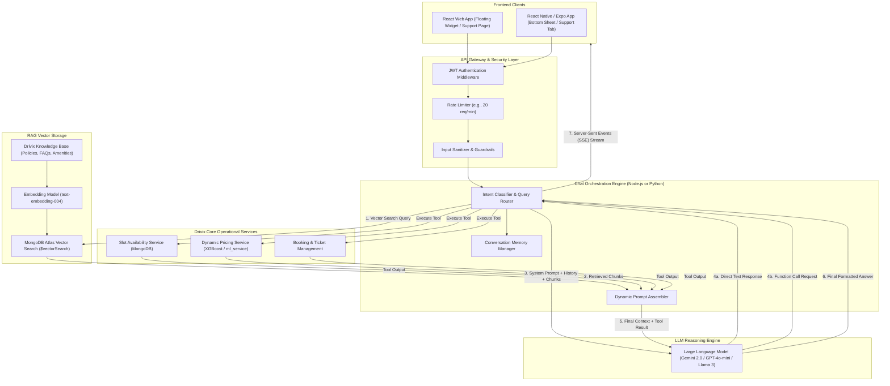
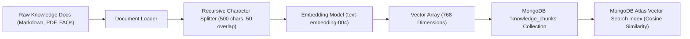
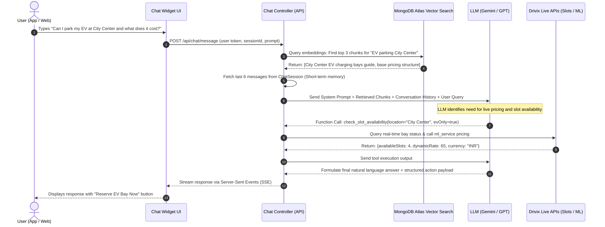
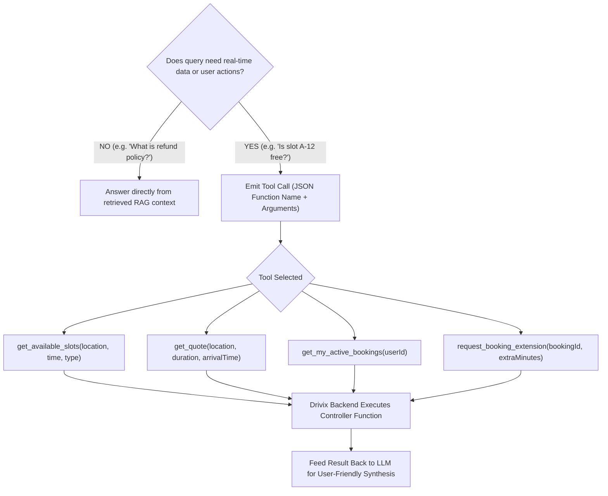
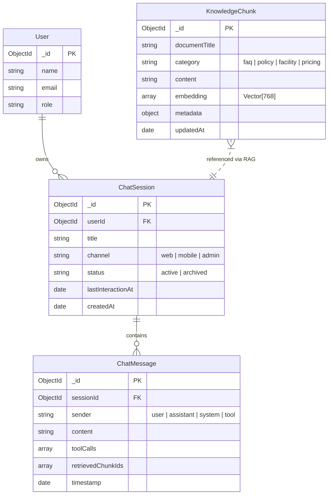
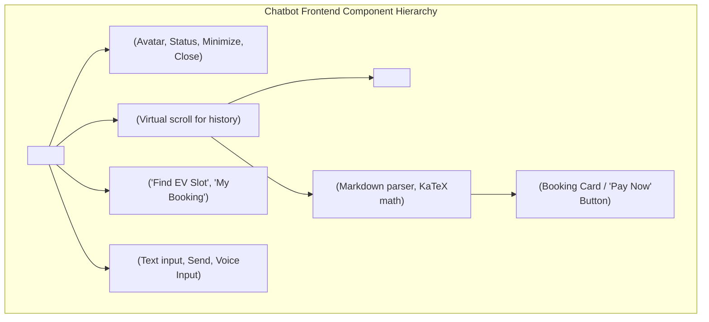
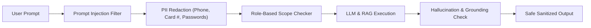
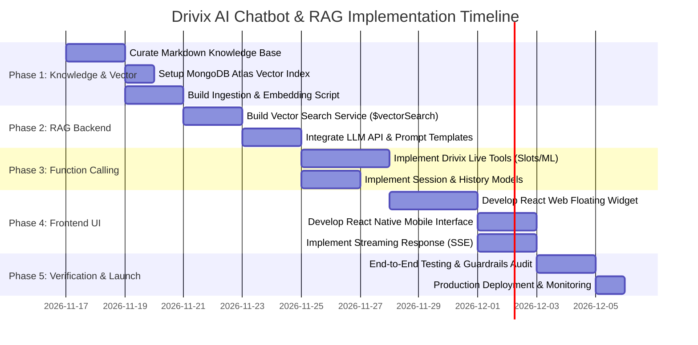

# Drivix AI Chatbot & RAG Architecture Specification

This document provides a comprehensive, production-grade architectural specification for building and integrating an AI Chatbot powered by **Retrieval-Augmented Generation (RAG)** and **Agentic Tool Calling** into the existing **Drivix Smart Parking Ecosystem**.

---

## 1. Executive Summary & Vision

The Drivix AI Assistant transforms static parking search and customer support into an intelligent, conversational experience. It blends two core AI capabilities:

1. **Retrieval-Augmented Generation (RAG)**: Answers questions on parking policies, gate navigation, pricing transparency, EV charging facilities, overstay penalties, and FAQs using verified domain documents.
2. **Agentic Tool Calling (Live Database & ML Execution)**: Performs real-time actions—such as searching available slots, quoting dynamic prices via the Drivix XGBoost model, retrieving active tickets, and extending reservations.

---

## 2. End-to-End System Architecture

The following flowchart illustrates how the Chatbot connects Web and Mobile clients, the Node.js/Express backend, the MongoDB Vector Store, the Python ML Service, and the LLM reasoning engine.



---

## 3. Data Ingestion & RAG Vector Pipeline

Before users can query policies and facility guides, documents must be processed, chunked, embedded, and indexed.



### Ingestion Steps
1. **Document Curation**: Store documents in a structured folder (`knowledge_base/`), covering:
   - `parking_rules.md` (overstay fines, cancellation windows, refund policies).
   - `facility_profiles.md` (locations, height clearances, EV charger specs, handicapped access).
   - `how_to_use.md` (QR entry procedures, Fastag, wallet payments, payment receipts).
2. **Chunking**: Break documents into chunks of 400–600 tokens with 50-token overlaps to preserve semantic continuity.
3. **Embedding Generation**: Vectorize each chunk via Google Gemini `text-embedding-004` (768 dimensions) or OpenAI `text-embedding-3-small` (1536 dimensions).
4. **Vector Indexing**: Store inside a MongoDB collection with an Atlas Vector Search index using `cosine` similarity.

---

## 4. Query & Response Sequence Diagram

This sequence diagram details the lifecycle of a user asking a question that requires both RAG context and live data retrieval.



---

## 5. Agentic Function Calling / Tool Definitions

The LLM is provided with structured JSON schemas representing callable Drivix APIs:



### Detailed Tool Specifications

1. **`get_available_slots`**:
   * *Parameters*: `locationId` (string), `vehicleType` (car/bike/ev), `entryTime` (ISO string).
   * *Returns*: Available bay count, bay numbers, nearest entrance gate.
2. **`get_quote`**:
   * *Parameters*: `locationId` (string), `durationHours` (number), `entryTime` (ISO string).
   * *Underlying Service*: Calls `ml_service/predict.py` (XGBoost model) + deterministic pricing multiplier.
   * *Returns*: Base rate, surge multiplier ($0.97\times - 1.05\times$), total INR price, demand level.
3. **`get_my_active_bookings`**:
   * *Parameters*: Implicitly derived from authenticated JWT `req.user.id`.
   * *Returns*: Active QR code link, parking bay name, start time, remaining time.
4. **`request_booking_extension`**:
   * *Parameters*: `bookingId` (string), `additionalMinutes` (integer).
   * *Returns*: Success status, additional amount due, updated expiry timestamp.

---

## 6. Database Schema Design (MongoDB)

To support conversational threads, context memory, and vector retrieval, three MongoDB models are introduced:



### MongoDB Atlas Vector Search Index Definition
```json
{
  "fields": [
    {
      "type": "vector",
      "path": "embedding",
      "numDimensions": 768,
      "similarity": "cosine"
    },
    {
      "type": "filter",
      "path": "category"
    }
  ]
}
```

---

## 7. REST & Streaming API Specifications

| Method | Endpoint | Description | Auth Required |
| :--- | :--- | :--- | :--- |
| `POST` | `/api/chat/sessions` | Initialize or resume a conversation thread | Yes (JWT) |
| `GET` | `/api/chat/sessions` | List user's past chat sessions | Yes (JWT) |
| `GET` | `/api/chat/sessions/:id/messages`| Retrieve historical message log for a session | Yes (JWT) |
| `POST` | `/api/chat/message` | Send message & receive streamed response (SSE) | Yes (JWT) |
| `POST` | `/api/chat/feedback` | Submit thumbs up/down and text feedback | Yes (JWT) |
| `POST` | `/api/chat/admin/sync-kb` | Ingest/re-index updated Markdown knowledge files| Admin Only |

### Streaming Protocol (Server-Sent Events)
For responsive UI interaction, `/api/chat/message` streams tokens in real-time:
```http
HTTP/1.1 200 OK
Content-Type: text/event-stream
Cache-Control: no-cache
Connection: keep-alive

data: {"type": "token", "content": "Sure! "}
data: {"type": "token", "content": "There are "}
data: {"type": "token", "content": "4 EV charging bays "}
data: {"type": "tool_execution", "tool": "get_quote", "result": {"totalInr": 120}}
data: {"type": "token", "content": "available at City Center for ₹120."}
data: {"type": "action_card", "action": "OPEN_BOOKING", "payload": {"location": "City Center"}}
data: {"type": "done"}
```

---

## 8. Frontend UI/UX Architecture



* **Web**: Floating action pill in bottom-right corner (`z-index: 9999`) that expands into a 400px $\times$ 600px drawer.
* **Mobile**: Bottom sheet modal (using `@gorhom/bottom-sheet` in React Native) or dedicated tab inside the Driver App.
* **Actionable Cards**: When the bot returns parking options, it renders interactive cards with a direct "Book This Bay" button that pre-fills the checkout screen.

---

## 9. Security, Privacy & Guardrails



1. **Prompt Injection Defense**: Prepend strict system rules instructing the model to reject instructions asking it to reveal internal system prompts or bypass security.
2. **Access Isolation**: The tool execution layer checks `req.user.id`. A user can never query or cancel another driver's booking.
3. **Data Privacy**: Redact sensitive payment information, credit card numbers, and raw passwords before text is sent to the LLM API.
4. **Fallback Handling**: If the vector database or LLM is unreachable, the system falls back to a deterministic rule-based FAQ response and surfaces the customer support phone number.

---

## 10. Phased Implementation Roadmap



---

## 11. Conclusion & Immediate Next Steps

Integrating a RAG-powered chatbot with tool calling is a high-impact, natural evolution for Drivix. Because your infrastructure already leverages MongoDB, Node.js, and an advanced Python dynamic pricing ML service, **more than 70% of the foundational plumbing is already in place**.

The next actionable step is to create the initial knowledge base files and set up the MongoDB vector search collection.

